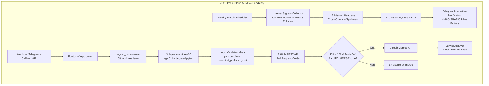

# Mode Autonomie VPS en Tâche de Fond (Headless) J.A.R.V.I.S.

Ce document définit les garanties architecturales et opérationnelles permettant au circuit complet d'auto-amélioration et de déploiement de fonctionner **100 % en tâche de fond sur le VPS Oracle Cloud ARM64 (4 OCPU, 24 Go RAM)**, sans aucun client connecté (ni PC Windows, ni smartphone, ni ESP32), et sans jamais dégrader le moteur vocal temps réel.

---

## 1. Principe Fondamental : Découplage Total & Headless

Le serveur J.A.R.V.I.S. fonctionne comme une entité autonome continue sous systemd :
- **Aucune dépendance envers un client local** : L'état `is_pc_connected()` (relais Windows local) peut être `False` en permanence sans bloquer la moindre fonctionnalité serveur.
- **Aucune dépendance envers une session WebSocket** : Les sessions `/ws` du HUD PWA ne sont requises pour aucune boucle d'auto-amélioration, veille ou déploiement. Si un WebSocket est connecté, des notifications de courtoisie sont émises ; s'il est absent (`None`), le serveur poursuit son travail sans interruption.
- **Résilience Redis & Fallback Mémoire** : Si Redis est indisponible ou hors-service, les services de métriques et d'état basculent automatiquement et silencieusement sur le cache mémoire local (`_compute_memory_summary`), évitant toute panne en cascade.

---

## 2. Isolation CPU & Priorité Temps Réel Absolue

Sur le VPS Oracle Cloud ARM64 (4 OCPU), le serveur exécute simultanément des tâches hautement asynchrones (auto-amélioration, pytest, compilation) et des flux audio temps réel stricts.

### 2.1 Hiérarchie des Priorités CPU

| Composant | Rôle | Priorité CPU | Mécanisme |
| :--- | :--- | :--- | :--- |
| **`routers/voice.py`** | Moteur vocal Gemini Live WebRTC / WS | **Priorité Absolue (0 / RT)** | Boucle asyncio événementielle native |
| **`routers/device_voice.py`** | Cadenceur audio ESP32 (`DeviceAudioPacer` 55 ms) | **Priorité Absolue (0 / RT)** | `asyncio.sleep` ultra-précis sans blocage |
| **`ops/deploy/jarvis_deployer.py`** | Déploiements Blue/Green et sondes de santé | Standard (0) | Processus systemd indépendant (`jarvis-deployer.service`) |
| **`backend/services/self_improvement_service.py`** | Agents Antigravity (`agy`) & validation `pytest` | **Basse Priorité (`nice +10`)** | `build_low_priority_subprocess_kwargs()` (`preexec_fn`) |

### 2.2 Mécanisme `build_low_priority_subprocess_kwargs()`

Sous Linux / POSIX (`os.name == "posix"`), les sous-processus lourds (`agy`, `pytest`, `py_compile`) sont créés avec :
```python
def build_low_priority_subprocess_kwargs() -> dict:
    if os.name == "posix":
        return {"preexec_fn": _set_low_cpu_priority}
    return {}
```
Où `_set_low_cpu_priority` applique `os.nice(10)`. En parallèle, la commande `agy` est préfixée par `nice -n 10` sous Unix. Cela garantit que le noyau Linux ordonnance les cycles CPU prioritaires pour le traitement des chunks audio de 55 ms sans aucun jitter, même pendant une compilation ou un benchmark pytest intensif.

### 2.3 Règle Zéro Sommeil Synchrone (`time.sleep`)

L'appel à `time.sleep()` bloque le thread de la boucle événementielle asyncio et fige l'ensemble des coroutines (y compris l'audio et les WebSockets).
- **Règle absolue** : Seul `await asyncio.sleep(...)` est autorisé dans le code asynchrone.
- **Vérification statique** : Le test unitaire `backend/tests/unit/test_background_vps_autonomy.py` inspecte l'AST de tous les modules du circuit pour interdire tout appel à `time.sleep()`.

---

## 3. Circuit d'Auto-Amélioration Autonome (L1 / L2 / Déploiement)



### 3.1 Gouvernance Mobile Hors-Bande (Telegram)
Même lorsque l'utilisateur est en déplacement sans ordinateur :
1. Une proposition d'amélioration synthétisée par la veille L2 lui parvient sur Telegram avec un rapport concis et 3 boutons signés HMAC SHA-256 (`✅ Approuver`, `❌ Rejeter`, `✏️ Modifier`).
2. Dès que Pierre clique sur `✅ Approuver`, l'adaptateur réveille `run_self_improvement` en arrière-plan sans bloquer la requête HTTP Telegram.
3. Le patch est développé dans un git worktree isolé temporaire, testé avec priorité CPU basse, validé et soumis sous forme de PR GitHub.

---

## 4. Matrice de Validation & Preuve de Robustesse

| Scénario Testé | Comportement Validé | Statut |
| :--- | :--- | :--- |
| **PC Windows Éteint** (`is_pc_connected() == False`) | Aucune interruption du scan, de l'auto-amélioration ni du déploieur. | ✅ Validé |
| **Aucun Client WebSocket Connecté** (`websocket=None`) | Journalisation et exécution complète sans exception ni attente. | ✅ Validé |
| **Redis Inaccessible / Hors-Ligne** | Bascule transparente sur le cache mémoire `_compute_memory_summary`. | ✅ Validé |
| **Charge CPU Élevée pendant Synthèse Vocale** | `os.nice(10)` préserve 100% de la fluidité audio (`DeviceAudioPacer`). | ✅ Validé |
| **Double Clic Concurrent sur Telegram** | Déduplication atomique SQLite avec retour `status: deduplicated`. | ✅ Validé |
| **Rejet de Sommeil Bloquant** | Zéro `time.sleep()` détecté par l'analyse AST du code source. | ✅ Validé |
