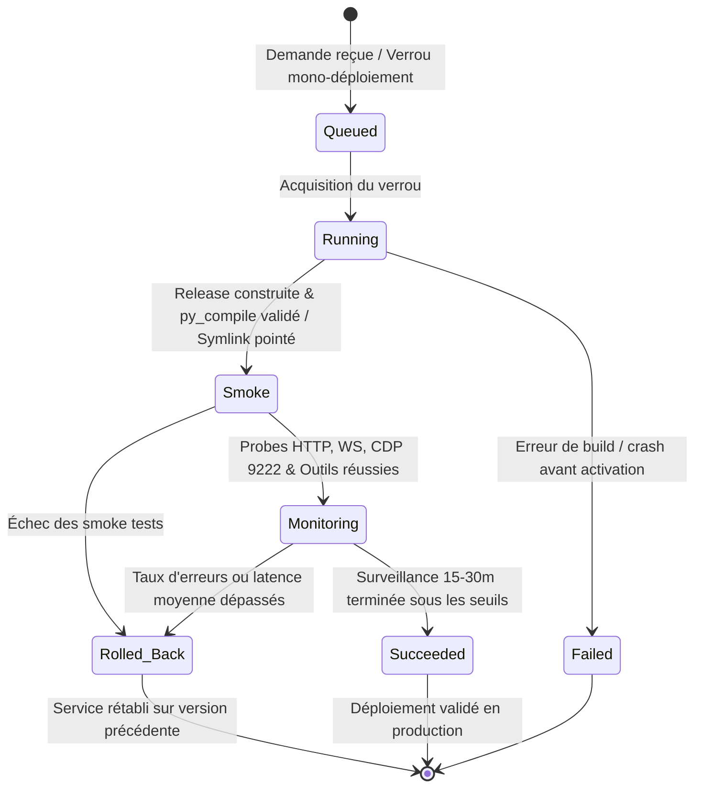

# J.A.R.V.I.S. VPS Deployer — Service Autonome Indépendant

## 1. Vue d'ensemble & Architecture

Le **J.A.R.V.I.S. VPS Deployer** (`ops/deploy/jarvis_deployer.py`) est un orchestrateur de déploiement autonome fonctionnant sous son propre service systemd (`jarvis-deployer.service`), entièrement séparé du service applicatif principal `jarvis.service`.

### Caractéristiques majeures
- **Indépendance stricte** : Si `jarvis.service` plante ou subit une régression critique, le déployeur reste opérationnel pour diagnostiquer, redémarrer ou exécuter un rollback automatique.
- **Zéro dépendance client** : Aucune intervention requise depuis l'interface Web/PWA, PC Windows ou microcontrôleur ESP32. Fonctionne 100% headless sur le VPS Oracle Cloud.
- **Pattern Blue/Green** : Déploiements isolés dans `releases/<timestamp>` et bascule atomique via le lien symbolique `current`.
- **Machine à états persistante** : `queued` → `running` → `smoke` → `monitoring` → `succeeded` | `rolled_back` | `failed`.
- **Journal append-only** : Double traçabilité via base SQLite (`deployments.db`) et journal d'événements JSON Lines (`deployer_journal.jsonl`).
- **Filtrage automatique des secrets** : Aucun token, mot de passe, clé d'API ou credential n'est consigné dans les logs ou journaux.
- **Surveillance active (15-30 min) & Auto-Rollback** : Analyse continue du taux d'erreur et de la latence ; retour arrière immédiat en cas de franchissement de seuil.
- **Notifications Telegram directes** : Expédiées directement via l'API Telegram Bot (`https://api.telegram.org/bot<TOKEN>/sendMessage`), sans passer par les routeurs de Jarvis.

---

## 2. Machine à États & Cycle de Vie



### Détail des statuts
1. **`queued`** : Requête enregistrée en base, en attente du verrou mono-instance `deployer.lock`.
2. **`running`** : Copie des sources dans `releases/<id>`, exclusions des caches/secrets, contrôle strict `py_compile`.
3. **`smoke`** : Bascule atomique du symlink `current`, redémarrage de `jarvis.service`, exécution des sondes préalables (HTTP 200, handshake WebSocket, Chrome CDP port 9222, syntaxe des déclarations et dispatchers d'outils).
4. **`monitoring`** : Surveillance périodique (intervalle paramétrable, par défaut 15s) sur 15 à 30 minutes. Mesure de latence et du taux d'erreur.
5. **`succeeded`** : Période de surveillance achevée avec succès sans anomalie.
6. **`rolled_back`** : Restauration atomique du symlink vers la release précédente, redémarrage du service et alerte Telegram.
7. **`failed`** : Échec terminal (erreur syntaxique amont ou incident bloquant).

---

## 3. Reprise après Crash (Crash Recovery)

Au démarrage de `jarvis-deployer.service` (ou après un redémarrage inopiné du serveur VPS) :
1. La méthode `recover_or_resume()` scrute les déploiements restés au statut `queued`, `running`, `smoke` ou `monitoring`.
2. Pour les déploiements interrompus en phase `running` : marqués comme `failed` et verrou libéré.
3. Pour les déploiements interrompus en phase `smoke` ou `monitoring` : le déployeur déclenche un **rollback de sécurité immédiat** vers la dernière release saine connue, redémarre `jarvis.service` et émet une notification Telegram.

---

## 4. API Locale Loopback HTTP (Port 8001)

Le déployeur expose une API HTTP locale liée strictement à `127.0.0.1:8001` (zéro dépendance externe, protocole asyncio natif) :

| Méthode | Endpoint | Description |
|---|---|---|
| `GET` | `/health` | Statut du démon déployeur et release active courante |
| `GET` | `/status` | Déploiements en cours et historique récent |
| `GET` | `/deployments` | Historique détaillé des 50 derniers déploiements |
| `POST` | `/deploy` | Déclenche un nouveau déploiement (`source_dir`, `target_ref`, `metadata`) |
| `POST` | `/rollback` | Déclenche un rollback manuel immédiat vers la release précédente |

### Exemple d'appel local (cURL)
```bash
curl -X POST http://127.0.0.1:8001/deploy \
  -H "Content-Type: application/json" \
  -d '{"target_ref": "v5.95.0", "metadata": {"trigger": "pr_merge"}}'
```

---

## 5. Variables d'Environnement

| Variable | Défaut | Description |
|---|---|---|
| `JARVIS_WORKSPACE_DIR` | `/home/opc/jarvis-core` | Racine du projet Jarvis |
| `JARVIS_RELEASES_DIR` | `<workspace>/releases` | Dossier des releases immutables |
| `JARVIS_CURRENT_SYMLINK` | `<workspace>/current` | Lien symbolique vers la release active |
| `JARVIS_SERVICE_NAME` | `jarvis` | Nom de l'unité systemd gérant Jarvis |
| `JARVIS_DEPLOY_PORT` | `8001` | Port d'écoute de l'API locale du déployeur |
| `JARVIS_DEPLOY_MONITOR_SECONDS` | `900.0` (15 min) | Durée totale de la phase de surveillance |
| `JARVIS_DEPLOY_MONITOR_INTERVAL` | `15.0` | Intervalle en secondes entre deux sondes de surveillance |
| `JARVIS_DEPLOY_ERROR_THRESHOLD` | `0.05` (5%) | Seuil max de taux d'erreur toléré avant auto-rollback |
| `JARVIS_DEPLOY_MAX_LATENCY_MS` | `2500.0` | Seuil max de latence moyenne (ms) toléré |
| `TELEGRAM_BOT_TOKEN` | `-` | Jeton Bot Telegram pour notifications directes |
| `TELEGRAM_CHAT_ID` | `-` | Chat ID Telegram destinataire des alertes |

---

## 6. Commandes Opérationnelles & Installation Systemd

### Installation du service sur le VPS
```bash
sudo cp ops/scripts/jarvis-deployer.service /etc/systemd/system/
sudo systemctl daemon-reload
sudo systemctl enable --now jarvis-deployer.service
```

### Vérification et Supervision
```bash
sudo systemd-analyze verify ops/scripts/jarvis-deployer.service
sudo systemctl status jarvis-deployer.service
sudo journalctl -u jarvis-deployer.service -f
```

### Utilisation CLI directe
```bash
# Lancer le serveur autonome
python ops/deploy/jarvis_deployer.py --server

# Déclencher un déploiement
python ops/deploy/jarvis_deployer.py --deploy --ref "v5.95.0"

# Rollback manuel immédiat
python ops/deploy/jarvis_deployer.py --rollback

# Afficher l'état courant
python ops/deploy/jarvis_deployer.py --status
```
