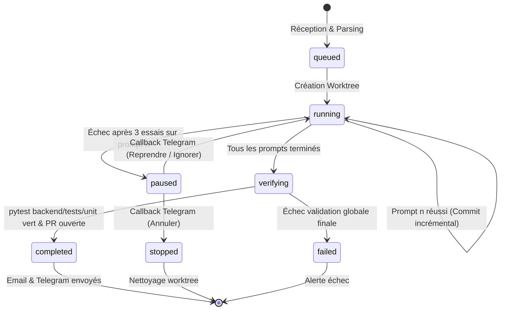

# Prompt Batch Runner J.A.R.V.I.S. (Documentation d'Architecture & Guide Opérationnel)

## 1. Vue d'Ensemble & Philosophie

Le **Prompt Batch Runner** (`services.prompt_batch_runner.py`) permet à Pierre Cassagnettes de soumettre un fichier Markdown contenant une série ordonnée de prompts (via Telegram, l'interface web PWA ou un chemin local sécurisé) afin que J.A.R.V.I.S. implémente, teste et valide toute la séquence **de A à Z en totale autonomie sur le VPS**.

### Principes Directeurs
1. **Zéro Intervention Humaine Requise** : L'agent enchaîne les prompts de manière séquentielle, compile, teste et commite chaque étape dans un git worktree dédié.
2. **Confinement Architectural Strict par Sous-Dossier** : Chaque prompt est confiné à son sous-dossier cible (`allowed_subdirs`), respectant le contrat d'`ARCHITECTURE.md` local.
3. **Sélection Dynamique du Modèle Antigravity** : Chaque prompt se voit attribuer le meilleur couple `(modèle, effort)` en interrogeant en direct le registre des modèles actifs.
4. **Priorité CPU Basse (`nice -n 10`)** : Préservation absolue du processeur pour le moteur vocal temps réel de Gemini Live (`routers/voice.py`).
5. **Persistance Atomique & Reprise après Crash** : État sauvegardé à chaque tentative dans `data/prompt_batches/{batch_id}.json`. Reprise exacte sans perte de travail.
6. **Contrôle Interactif Telegram** : En cas de blocage après 3 tentatives, pause immédiate et envoi d'alertes Telegram + Email avec boutons inline signés HMAC (`▶️ Reprendre`, `⏭️ Ignorer ce prompt`, `🛑 Annuler le batch`).
7. **Livraison Idempotente & Section Dédiée** : Une unique Pull Request GitHub est créée après une validation finale `pytest backend/tests/unit`, accompagnée d'un e-mail récapitulatif contenant la section obligatoire :
   `## Ce que tu dois faire ensuite`
   qui rassemble toutes les actions manuelles résiduelles.

---

## 2. Spécification du Format Markdown Tolérant

Le parser (`parse_prompt_batch_markdown`) accepte un format souple et résilient :

```markdown
# Migration et Refactorisation du Module X

## Prompt 1: Nettoyage et typage strict (low)
CONTRAINTES D'ÉCONOMIE DE TOKENS — LIS UNIQUEMENT :
- backend/services/module_x.py
- backend/core/shared_state.py

Ajouter les annotations de type Python 3.12+ et nettoyer les imports inutilisés.

COMMANDES DE VALIDATION :
pytest backend/tests/unit/test_module_x.py -q

À FAIRE PAR L'UTILISATEUR :
- Vérifier la variable X_API_KEY sur le portail tiers

---

## Prompt 2: Ajout des métriques et observabilité (high)
CONTRAINTES D'ÉCONOMIE DE TOKENS — LIS UNIQUEMENT :
- backend/services/module_x.py
- backend/services/metrics_service.py

Connecter le module à metrics_service et journaliser chaque exécution.

ACTIONS MANUELLES :
- Activer l'affichage du widget métriques dans le HUD si souhaité
```

### Règles de Parsing
- **En-têtes de prompt reconnus** : `## Prompt 1`, `### PROMPT 1A`, `## Étape 1 : Nom`, `# Prompt 2`.
- **Niveau d'effort / réflexion** :
  - `(low)` ou `NIVEAU : low` -> Modèle Flash le plus rapide + effort `low`.
  - `(medium)` ou `NIVEAU : medium` -> Modèle Flash le plus récent + effort `medium`.
  - `(high)` ou `NIVEAU : high` -> Modèle Pro/Sonnet actif + effort `high`.
- **Fichiers de référence / lecture seule** :
  - Détectés sous `LIS UNIQUEMENT :`, `CONTRAINTES D'ÉCONOMIE DE TOKENS`, `À LIRE :`.
  - Injectés comme contrainte de référence pour l'agent `agy`.
- **Actions manuelles réservées à l'utilisateur** :
  - Détectées sous `À FAIRE PAR L'UTILISATEUR`, `ACTIONS MANUELLES`, `CE QUE TU DOIS FAIRE ENSUITE`.
  - Extraites et consolidées dans le rapport final dans la section `## Ce que tu dois faire ensuite`.
- **Commandes de validation spécifiques** :
  - Détectées sous `COMMANDES DE VALIDATION :`, exécutées en complément des tests unitaires ciblés.
- **Règles de rejet** :
  - Fichier sans aucun prompt -> `ValueError`.
  - Prompt avec corps vide -> `ValueError`.
  - Identifiants de prompt en double -> `ValueError`.

---

## 3. Sécurité des Chemins (Anti Path-Traversal)

La fonction `validate_safe_batch_path(file_path)` garantit qu'aucun chemin malveillant ne peut s'échapper des périmètres autorisés :
- Autorise uniquement :
  - Le répertoire racine du dépôt (`REPO_ROOT`)
  - Le répertoire `downloads/`
  - Le répertoire `data/chat_uploads/`
  - Les dossiers temporaires standard (`/tmp`, `$TEMP`)
- Interdit formellement toute tentative de traversée (`..` s'échappant de ces racines).
- Lève `PermissionError` ou `FileNotFoundError` en cas d'anomalie.

---

## 4. Cycle de Vie & Machine à États

L'exécution d'un batch suit une machine à états stricte :



### Gestion des Essais & Rétroaction Ciblée
Pour chaque prompt :
1. L'agent dispose d'un maximum de **3 tentatives** (`MAX_PROMPT_ATTEMPTS = 3`).
2. À chaque essai échoué, seul le **traceback concis** et l'erreur d'échec sont réinjectés dans le prompt suivant sous :
   `ATTENTION : L'essai précédent a échoué avec l'erreur suivante : <traceback>`
3. En cas d'échec au 3ème essai :
   - Le statut passe à `paused`.
   - L'état est atomiquement persisté.
   - Une alerte Telegram prioritaire avec clavier inline interactif est transmise.
   - Un e-mail d'alerte détaillé est transmis.

---

## 5. Boutons Inline Telegram & HMAC SHA-256

Pour garantir l'authenticité et la concision sous la limite de 64 octets de Telegram, les callbacks utilisent le format :
`bpa:<action>:<batch_id>:<sig>`

- Actions :
  - `res` : `▶️ Reprendre` (réinitialise les essais à 1 pour le prompt en cours)
  - `skp` : `⏭️ Ignorer ce prompt` (enregistre le prompt comme `skipped` et passe au suivant)
  - `abt` : `🛑 Annuler le batch` (arrête la série et nettoie les ressources)
- Signature :
  `hmac.new(key, f"{action}:{batch_id}".encode(), sha256).hexdigest()[:12]`
- Vérification : En temps constant via `hmac.compare_digest`.

---

## 6. Intégration Gemini Live & Dispatcher

Le runner est accessible via :
1. **Outil Gemini Live `self_improve`** (52 outils au total, respectant le contrat strict de la palette) :
   - Paramètre optionnel : `batch_file_path="downloads/series_prompts.md"`
   - Paramètre optionnel : `batch_content="## Prompt 1 ..."`
2. **Alias direct `run_prompt_batch` / `prompt_batch`** dans `backend/core/tools/dispatcher.py` :
   - Exécution asynchrone non-bloquante pour la voix : annonce immédiate de lancement, notification finale vocale via `voice_injection_queue`.
   - Mode synchrone pour les tests ou les API REST : `sync=True`.

---

## 7. Service Systemd VPS

Le fichier `ops/scripts/jarvis-prompt-batch.service` permet la gestion du runner en arrière-plan sous systemd :
```bash
sudo cp ops/scripts/jarvis-prompt-batch.service /etc/systemd/system/
sudo systemctl daemon-reload
sudo systemctl enable jarvis-prompt-batch
```
