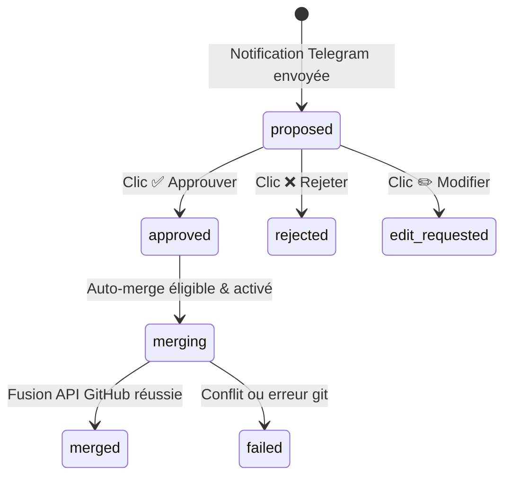

# Adaptateur Telegram Interactif d'Auto-Amélioration (J.A.R.V.I.S.)

## 1. Vue d'Ensemble

L'adaptateur Telegram interactif (`backend/services/self_improvement_telegram.py`) permet à Pierre de superviser directement depuis son smartphone les propositions d'auto-amélioration et les Pull Requests générées par les agents Antigravity sur le VPS Oracle Cloud.

À l'issue de chaque session d'auto-amélioration réussie, un rapport concis et structuré est expédié sur Telegram avec trois boutons inline :
- **`✅ Approuver`** : Valide la proposition. Si les conditions strictes de merge automatique sont satisfaites et que `AUTO_MERGE_ENABLED=true`, la branche est fusionnée sur `main`. Sinon, elle reste approuvée en attente de validation manuelle sur GitHub.
- **`❌ Rejeter`** : Rejette la proposition et clôture l'intervention.
- **`✏️ Demander une modification`** : Signale à l'agent autonome qu'une révision ciblée est requise.

---

## 2. Machine à États Persistante (SQLite)

Le cycle de vie complet d'une proposition est persisté dans SQLite (`data/self_improvement_proposals.db`) :



### Garanties de Résilience
1. **Déduplication atomique des doubles clics** : Les transitions s'exécutent au sein d'une transaction SQLite conditionnelle (`UPDATE ... WHERE status IN (...)`). Tout clic subséquent est intercepté et renvoie le statut `deduplicated` sans altérer l'état.
2. **Reprise après redémarrage** : Toutes les propositions non closes (`status IN ('proposed', 'merging')`) sont conservées en base et réconciliables au redémarrage du service systemd.
3. **Mise à jour visuelle du message** : Dès qu'une décision est prise, le message Telegram d'origine est édité via `editMessageText` pour afficher le statut final et désactiver le clavier inline.

---

## 3. Sécurité des Callbacks & Signatures HMAC

Pour respecter strictement la limite de **64 octets** imposée par l'API Telegram sur `callback_data`, un protocole compact signé est mis en œuvre :

$$\text{Format} : \texttt{si:\{action\}:\{proposal\_id\}:\{hmac\_sig\}}$$

- `si` : Préfixe d'espace de nom (`self_improvement`).
- `action` : Code d'action compact (`app` pour approuver, `rej` pour rejeter, `edit` pour modifier).
- `proposal_id` : Identifiant non devinable au format `prop_<12_hex>` (ex: `prop_8f3a1b0c9e2d`).
- `hmac_sig` : Empreinte HMAC SHA-256 tronquée à 12 caractères calculée avec `TELEGRAM_HMAC_SECRET`.

> **Sécurité** : La vérification utilise `hmac.compare_digest` en temps constant, prévenant toute falsification de vote ou attaque par temporisation.

---

## 4. Politique de Merge Automatique Sécurisée

Le merge automatique direct sur la branche `main` applique le principe de défense en profondeur :

| Critère de Contrôle | Seuil / Condition Obligatoire | Conséquence en cas de non-respect |
| :--- | :--- | :--- |
| **Drapeau Global** | `AUTO_MERGE_ENABLED=true` (**Désactivé par défaut**) | Reste en statut `approved` (merge manuel requis sur GitHub). |
| **Volume du Patch** | $\text{diff\_line\_count} < 150\text{ lignes}$ | Auto-merge refusé si $\ge 150$ lignes. |
| **Validation des Tests** | `tests_passed == True` (porte `pytest` ciblée verte) | Auto-merge strictement interdit en cas de régression. |
| **Chemins Protégés** | Aucun fichier sensible touché (`.env*`, `auth_service.py`, `key_gate.py`, etc.) | Rejet immédiat par `check_protected_paths.py`. |
| **Revue Second Modèle** | `second_model_reviewed == True` | Exige la confirmation d'une revue par un modèle LLM indépendant. |

---

## 5. Configuration & Absence de Valeurs en Dur

Conformément aux directives de sécurité, **aucune IP ni aucun `chatId` n'est codé en dur**. Tous les paramètres sont résolus dynamiquement via `backend/config.py` et les variables d'environnement :

```bash
# Configuration Telegram
TELEGRAM_BOT_TOKEN="<votre_token_bot_telegram>"
TELEGRAM_CHAT_ID="<votre_chat_id_telegram>"
TELEGRAM_HMAC_SECRET="<secret_hmac_aleatoire_robuste>"

# Gouvernance de fusion
AUTO_MERGE_ENABLED="false"  # false par défaut pour sécurité maximale
```

---

## 6. Commandes de Validation

```bash
# Vérification de syntaxe
python -m py_compile backend/services/self_improvement_telegram.py

# Exécution de la suite de tests unitaires ciblés
env CI=1 GIT_TERMINAL_PROMPT=0 python -m pytest -q backend/tests/unit/test_self_improvement_telegram.py backend/tests/unit/test_self_improvement_service.py
```
