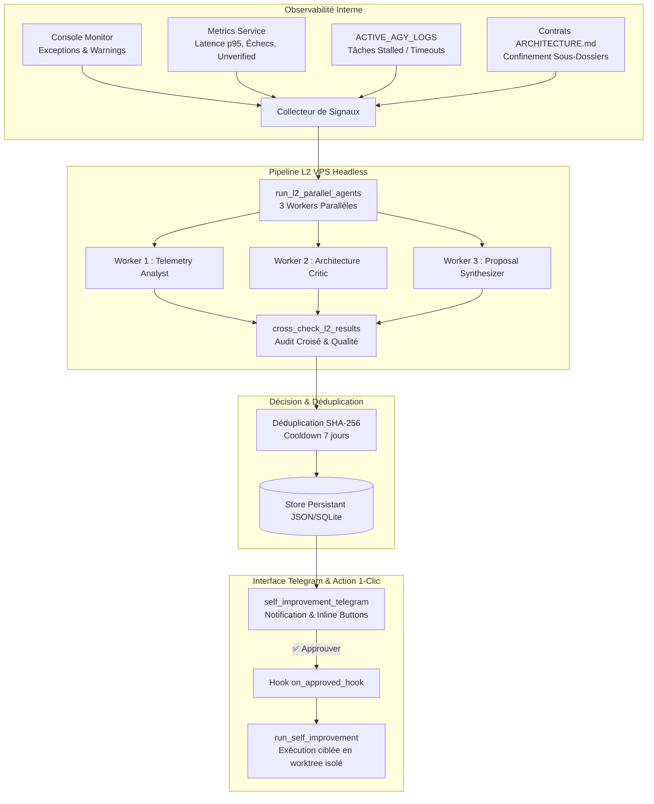

# 🛰️ Moteur de Veille et Propositions d'Auto-Amélioration (`weekly_improvement_watch`)

Le service **Weekly Improvement Watch** (`backend/services/weekly_improvement_watch.py`) est le moteur autonome d'auto-observation et d'évolution continue de J.A.R.V.I.S. Il analyse périodiquement les performances réelles du système, formule 1 à 3 propositions concrètes d'améliorations et les transmet à Pierre sur Telegram avec des boutons d'action interactifs à déclenchement en 1 clic.

---

## 1. Architecture & Flux de Données



---

## 2. Signaux Internes Analysés

| Source | Métriques et Événements Capturés | Rôle dans la Veille |
| :--- | :--- | :--- |
| **`console_monitor.py`** | Erreurs récentes, traceback, warnings fréquents, regroupement par module (`source`). | Détecter les composants instables ou produisant du bruit technique. |
| **`metrics_service.py`** | Latence moyenne et p95 des outils, taux d'échec (`failure_rate`), timeouts, `claimed_success_without_verification`. | Identifier les goulots d'étranglement et les outils affirmant un succès sans preuve d'effet de bord. |
| **`ACTIVE_AGY_LOGS`** | Statuts de tâches Antigravity (`stalled`, `timeout`), temps depuis la dernière émission (`last_output_at`). | Prévenir les blocages des sous-agents en tâche de fond. |
| **`ARCHITECTURE.md`** | Contrats de confinement des sous-dossiers (`backend`, `frontend`, `firmware`, `ops`, `docs`). | Garantir que chaque proposition respecte le périmètre strict et les règles architecturales. |

---

## 3. Pipeline L2 Parallèle (100 % Headless VPS)

- **Contrainte absolue de sécurité et d'environnement** :
  - **Interdiction stricte d'appeler Chrome local PC ou l'UI Gemini Web**.
  - Exécution 100 % headless sur le VPS Oracle Cloud (`158.178.206.213`).
  - Utilisation de `run_l2_parallel_agents` avec `MODEL_FLASH` et effort medium/high.
- **Rôles des sous-agents L2** :
  1. `telemetry_analyst` (`critic`) : diagnostic approfondi des latences, échecs et métriques.
  2. `architecture_critic` (`critic`) : évaluation des risques d'architecture et conformité aux règles modulaires.
  3. `proposal_synthesizer` (`architect`) : formalisation de **1 à 3 propositions** concrètes et calibrées.
- **Audit de convergence croisé** :
  - Contrôle automatique via `cross_check_l2_results` (détection de contradictions, absence de sources, validation du format).
  - En cas d'indisponibilité du LLM ou d'épuisement de quota, bascule immédiate sur un **générateur déterministe de repli** basé sur les signaux les plus forts (outil le plus lent, source d'erreurs la plus fréquente, etc.).

---

## 4. Format Standardisé des Propositions

Chaque proposition d'amélioration générée respecte le format strict suivant :

```json
{
  "proposal_id": "watch_prop_a1b2c3d4",
  "title": "Optimisation de la résilience et des timeouts de browser_agent",
  "target_subfolder": "backend/services/browser_agent",
  "recommended_complexity": "medium",
  "rationale": "Latence p95 observée à 3400ms sur navigation_tool avec 2 timeouts récents.",
  "ready_to_run_prompt": "Refactoriser le navigateur headless pour intégrer un retry exponentiel, un cache de sélecteurs et une purge propre des contextes en erreur.",
  "targeted_tests": [
    "backend/tests/unit/test_browser_agent.py"
  ]
}
```

### Déduplication
- Empreinte SHA-256 calculée sur `f"{target_subfolder}:{title}"`.
- Fenêtre de cooldown de **7 jours** : une proposition similaire déjà soumise ou en cours de traitement n'est pas réémise pour éviter de polluer l'attention de Pierre.

---

## 5. Interaction Telegram & Déclenchement en 1 Clic

1. **Notification enrichie** :
   - Rapport HTML clair avec statut, objectif, sous-dossier, justification et tests ciblés.
   - Clavier inline Telegram signé HMAC-SHA256 (`✅ Approuver`, `❌ Rejeter`, `✏️ Modifier`).
2. **Déclenchement automatique** :
   - Lorsque Pierre clique sur `✅ Approuver`, le callback `on_approved_hook` de l'adaptateur Telegram intercepte l'événement.
   - Le moteur lance automatiquement `run_self_improvement` en tâche asynchrone non-bloquante avec :
     - `goal = ready_to_run_prompt`
     - `target_subfolder = target_subfolder`
     - `complexity = recommended_complexity`
     - `create_pr = True` (worktree Git dédié et création de PR GitHub).

---

## 6. Scheduler Asynchrone Serveur

- **Classe** : `WeeklyImprovementWatchService` (alias `WeeklyImprovementWatchScheduler`).
- **Comportement** :
  - Idempotent : `start()` vérifie si la tâche tourne déjà avant de la lancer.
  - Intervalle configurable (par défaut : 7 jours / `604 800` secondes).
  - Arrêt propre et gracieux via `stop()`.
- **Exécution manuelle à la demande** :
  ```python
  from services.weekly_improvement_watch import weekly_improvement_watch_service

  # Déclenche un scan immédiat
  proposals = await weekly_improvement_watch_service.run_scan()
  ```

---

## 7. Commandes de Validation

```bash
# Vérification de syntaxe
timeout 120 python -m py_compile backend/services/weekly_improvement_watch.py

# Exécution de la suite de tests unitaires ciblée
timeout 120 env CI=1 GIT_TERMINAL_PROMPT=0 python -m pytest -q backend/tests/unit/test_weekly_improvement_watch.py
```
